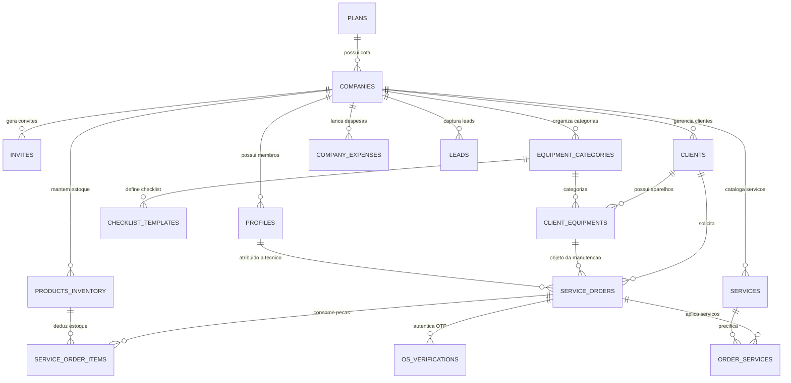
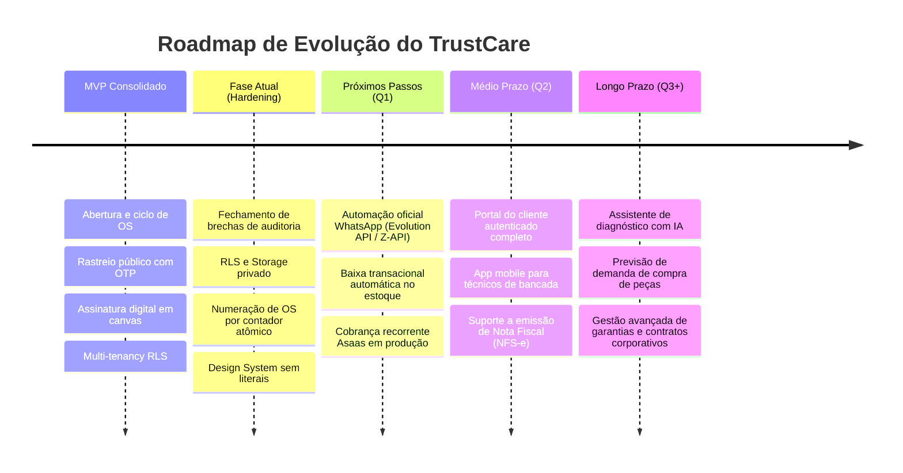

# Product Requirements Document (PRD) — TrustCare (OS Manager)

> **Documento Oficial de Requisitos de Produto**  
> **Versão:** 1.0.0 (Post-MVP / Hardening)  
> **Status:** Ativo / Em Produção & Evolução Contínua  
> **Última Atualização:** 17 de Outubro de 2026  
> **Responsáveis:** TrustCare Product & Engineering Team  

---

## 1. Visão Geral do Produto e Contexto

### 1.1 Declaração do Problema
Assistências técnicas de informática, conserto de eletrônicos, smartphones e prestadores de serviços gerenciados de TI (MSPs) operam frequentemente sob processos manuais, fragmentados ou baseados em papéis e planilhas. Esse cenário gera:
- **Perda de Rastreabilidade Operacional:** Incerteza do cliente sobre o estado de seu equipamento, gerando sobrecarga de atendimento via telefone/WhatsApp.
- **Risco Jurídico e Desacordo de Orçamentos:** Ausência de assinaturas auditáveis no aceite de orçamentos e checklists de entrada/saída inconsistentes.
- **Vazamento Financeiro e Furo de Estoque:** Peças utilizadas na bancada sem baixa automática de estoque ou custos não computados na margem real do serviço.
- **Falta de Isolamento em Soluções Multi-Tenant:** Soluções de mercado que não garantem conformidade com a LGPD ou misturam dados entre empresas parceiras.

### 1.2 Visão da Solução
O **TrustCare (OS Manager)** é uma plataforma **SaaS Multi-Tenant Cloud-Native** projetada para gerenciar o ciclo de vida completo de assistências técnicas e serviços de TI. A solução conecta recepção, bancada técnica, gestão de estoque, controle financeiro e autoatendimento transparente do cliente final sob uma experiência minimalista suíça (*Swiss Technical Minimalism*), com isolamento estrito de dados no banco PostgreSQL via Row Level Security (RLS).

### 1.3 Pilares Estratégicos
1. **Isolamento e Segurança Multi-Tenant (P0):** Nenhuma empresa acessa dados de outra. Regras de RLS, funções seguras e cotas de armazenamento por plano isolam clientes, mídias e registros.
2. **Autoatendimento e Transparência Radical:** O cliente final consulta o status do equipamento em tempo real com autenticação OTP e aprova orçamentos com assinatura digital manuscrita com validade jurídica auditável.
3. **Integridade Operacional e Financeira Unificada:** A execução da ordem de serviço conecta-se automaticamente ao estoque de peças e à projeção de fluxo de caixa da empresa.
4. **Agilidade de Bancada e Ergonomia:** Interface de alta densidade sem poluição visual, suporte a atalhos rápidos de teclado (Command Palette `Ctrl+K`), e conformidade estética estrita sem uso de clichês visuais.

---

## 2. Perfis de Usuários (Personas) e Matriz de Permissões (RBAC)

| Papel | Persona | Responsabilidades Principais | Nível de Acesso (RBAC) |
|---|---|---|---|
| **Admin** | Proprietário / Gerente Geral | Gestão de equipe, plano de assinatura, faturamento, despesas operacionais, relatórios financeiros, configurações gerais da empresa. | Acesso irrestrito a todos os dados do tenant (`company_id`). |
| **Technician** | Técnico de Bancada | Diagnóstico de equipamentos, preenchimento de laudos técnicos, checklists de entrada/saída, aplicação de peças e serviços, avanço de status de OS. | Leitura/escrita de OS, clientes, equipamentos e estoque; sem acesso a despesas gerais e faturamento consolidado da empresa. |
| **Viewer** | Atendente / Balcão | Abertura de OS, cadastro de novos clientes, consulta de status e agendamento de retiradas. | Apenas visualização de dados operacionais e criação básica de OS/clientes; sem permissão de exclusão ou alteração de configurações. |
| **End Client** | Cliente Final (Público) | Acompanhamento do progresso da OS, revisão de orçamentos e assinatura digital de aprovação. | Acesso público restrito via rota `/rastreio` (com OTP de 6 dígitos) e `/orcamento/[id]`. Sem acesso direto às tabelas internas. |
| **God Mode** | Super Admin da Plataforma | Monitoramento de métricas globais de tenants, auditoria de uso e suporte de infraestrutura. | Rota `/backoffice` protegida por service role e validação fixa de e-mail de mantenedor do sistema. |

---

## 3. Requisitos Funcionais (Módulos do Sistema)

### Módulo 1: Multi-Tenancy, Autenticação e Assinatura SaaS
- **RF-1.1 (Autocadastro de Empresa):** Permite o registro de novas empresas através de `/register`. Um trigger transacional cria a empresa (`companies`) no plano `starter` em status de teste (`trialing`) e configura o usuário criador como perfil `admin`.
- **RF-1.2 (Convites de Equipe):** Administradores podem gerar convites por e-mail com token seguro (`invites`) e data de expiração (7 dias) para papéis `admin`, `technician` ou `viewer`.
- **RF-1.3 (Planos de Assinatura e Cotas):**
  - **Starter:** 1 técnico, 1 GB de armazenamento de mídias.
  - **Pro:** 3 técnicos, 5 GB de armazenamento de mídias.
  - **Premium:** Técnicos ilimitados, 50 GB de armazenamento de mídias.
- **RF-1.4 (Ciclo de Cobrança e Bloqueio de Inadimplência):** Integração com gateway de pagamentos (Asaas) via webhook. Em caso de status `canceled` ou `past_due` com mais de 5 dias após a expiração, o sistema entra em modo *apenas-leitura*, bloqueando mutações em UI e banco de dados (`is_company_read_only`).

### Módulo 2: Gestão de Ordens de Serviço (Core da Bancada)
- **RF-2.1 (Código Híbrido Amigável `TC-YYYY-XXXX`):** Toda OS criada recebe automaticamente um identificador sequencial por empresa e ano civil (ex: `TC-2026-0001`), gerenciado por contador transacional seguro no banco de dados.
- **RF-2.2 (Máquina de Estados de 10 Etapas):** O fluxo operacional segue estritamente a sequência de status:
  1. `Aguardando Equipamento`
  2. `Em Análise` (grava irreversivelmente `analysis_started_at` para cálculo de SLA)
  3. `Aguardando Aprovação`
  4. `Aprovado`
  5. `Aguardando Peças`
  6. `Em Execução`
  7. `Em Testes`
  8. `Pronto para Retirada`
  9. `Finalizado` (encerra ciclo técnico e exige conciliação financeira)
  10. `Cancelado` (estorna peças no estoque)
- **RF-2.3 (Checklists Dinâmicos de Entrada e Saída):** Formulários estruturados em JSONB customizáveis por categoria de equipamento (ex: estado da carcaça, carregador incluso, liga/não liga, biometria funcional).
- **RF-2.4 (Anexos e Mídias de Bancada):** Upload de fotos e vídeos de comprovação do estado do equipamento no bucket privado `os-media`, organizados por empresa e OS.

### Módulo 3: Clientes e Equipamentos (Inventário do Cliente)
- **RF-3.1 (Cadastro Unificado PF/PJ):** Registro de clientes com diferenciação por documento (CPF ou CNPJ), contatos (telefone/WhatsApp, e-mail) e endereço.
- **RF-3.2 (Inventário de Aparelhos):** Vínculo de equipamentos ao cliente com especificações completas (Categoria, Marca, Modelo, Número de Série, Processador, Memória RAM, Armazenamento e GPU).
- **RF-3.3 (Histórico de Manutenções):** Rastreabilidade de todas as ordens de serviço anteriores vinculadas ao mesmo aparelho ou cliente.
- **RF-3.4 (Proteção de Integridade Referencial):** Impossibilidade de exclusão acidental de clientes que possuam ordens de serviço ativas ou históricas (regra `RESTRICT`).

### Módulo 4: Estoque de Peças e Catálogo de Serviços
- **RF-4.1 (Inventário de Peças):** Controle de componentes com SKU único, categoria, quantidade atual, preço de custo, preço de venda e alerta visual de estoque mínimo (`min_stock_alert`).
- **RF-4.2 (Baixa e Estorno Automático):** A inserção de peças em uma OS decrementa o estoque de forma transacional. O cancelamento da OS estorna automaticamente os itens ao inventário.
- **RF-4.3 (Catálogo de Mão de Obra):** Tabela de serviços padronizados com preço base sugerido e descrição técnica.

### Módulo 5: Gestão Financeira e Fluxo de Caixa
- **RF-5.1 (Recebimento de Ordens de Serviço):** Controle de quitação independente do status de bancada (`pendente`, `parcial`, `pago`), com registro de métodos aceitos (Pix, Cartão de Crédito/Débito, Dinheiro, Boleto).
- **RF-5.2 (Apuração de Margem Real de Lucro):** Cálculo automático cruzando receita do serviço e valor de venda das peças contra o custo real de aquisição dos componentes (COGS).
- **RF-5.3 (Controle de Despesas Fixas e Variáveis):** Módulo de despesas (`company_expenses`) com suporte a recorrências (Única, Diária, Semanal, Mensal, Anual) para projeção de custos operacionais e ponto de equilíbrio (*break-even*).
- **RF-5.4 (Exportação de Relatórios):** Capacidade de filtrar dados por período customizado e exportar tabelas analíticas para formato CSV.

### Módulo 6: Superfície Pública e Autoatendimento (LGPD Compliant)
- **RF-6.1 (Página Pública de Rastreio `/rastreio`):** Consulta por código da OS ou UUID. Implementa verificação segura via OTP (código numérico de 6 dígitos de uso único enviado por e-mail transacional via Resend com trava contra força bruta).
- **RF-6.2 (Blindagem de Privacidade - LGPD):** A tela pública de rastreio oculta deliberadamente dados de contato do cliente, valores monetários cobrados e documentos pessoais.
- **RF-6.3 (Aprovação de Orçamento com Assinatura Digital `/orcamento/[id]`):** Tela pública onde o cliente revisa itens, peças e valores do orçamento, e assina digitalmente em tela via canvas interativo HTML5 (`SignaturePad`). O sistema grava o desenho em base64, o IP do cliente e o timestamp da assinatura.
- **RF-6.4 (Portal do Cliente `/portal`):** Área de consulta agrupada onde clientes finais podem visualizar todas as ordens de serviço emitidas em seu CPF/CNPJ.

### Módulo 7: Notificações, Automações e Webhooks
- **RF-7.1 (Disparos Automáticos por E-mail):** E-mails transacionais (via Resend) enviados nos momentos críticos: abertura de OS, envio de orçamento para aprovação, autorização confirmada e equipamento pronto para retirada.
- **RF-7.2 (Webhooks para Mensageria WhatsApp):** Disparo de payload padronizado em JSON via POST (`NEXT_PUBLIC_WEBHOOK_URL`) em mudanças de status da OS, permitindo integração com n8n, Make e APIs de WhatsApp para comunicação direta com o cliente.

### Módulo 8: Módulos de Apoio Operacional
- **RF-8.1 (Funil de Vendas e Leads):** Quadro Kanban para qualificação de orçamentos prévios e potenciais clientes antes da entrada física do equipamento.
- **RF-8.2 (Agenda e Calendário de Prazos):** Visualização de prazos de entrega e compromissos técnicos organizados por data.
- **RF-8.3 (API Externa de Integração v1):** Rota `/api/v1/orders` para consulta e emissão de OSs por sistemas legados via cabeçalho `x-api-key`.

---

## 4. Requisitos Não Funcionais (NFRs)

### 4.1 Segurança e Privacidade
- **RNF-1.1 (RLS Universal):** 100% das tabelas de dados de tenant operam com Row Level Security ativado no PostgreSQL.
- **RNF-1.2 (Privilégio Mínimo e Storage Privado):** Buckets de arquivos operam com políticas restritivas baseadas no `company_id`. Acesso a mídias sensíveis geram URLs pré-assinadas com tempo de expiração curto.
- **RNF-1.3 (Rate Limiting):** Rotas de envio de e-mail e requisições públicas de OTP possuem limitador de taxa por IP para proteção contra abusos e DoS.
- **RNF-1.4 (Isolamento de Secrets):** Nenhuma chave de serviço (`SUPABASE_SERVICE_ROLE_KEY`, `RESEND_API_KEY`) é exposta no cliente Next.js.

### 4.2 Desempenho e Concorrência
- **RNF-2.1 (Latência de Resposta):** Operações normais do painel administrativo com tempo de resposta P95 inferior a 300ms.
- **RNF-2.2 (Bloqueio Transacional de Numeração e Estoque):** A geração do código `TC-YYYY-XXXX` e a dedução de estoque utilizam locks explícitos (`FOR UPDATE` / transações atômicas) para prevenir colisões sob concorrência simultânea.
- **RNF-2.3 (Core Web Vitals):** Páginas públicas (`/rastreio`, `/orcamento/[id]`) com LCP < 1.5s e CLS < 0.05.

### 4.3 Padrão Visual e Experiência do Usuário (Design System)
- **RNF-3.1 (Swiss Technical Minimalism):** Interface focada em legibilidade e densidade de dados, tipografia hierárquica baseada na superfamília **IBM Plex** (IBM Plex Sans, IBM Plex Mono e IBM Plex Sans Condensed).
- **RNF-3.2 (Banimento Estrito de Cores Proibidas):** Proibição total de tons violetas/roxos nas interfaces do sistema. Utilização de cinzas neutros de alto contraste, verde-esmeralda para estados de sucesso e azul técnico para execução.
- **RNF-3.3 (Zero FOUC de Tema):** Alternância instantânea de temas claro e escuro sem flashes de estilo não formatado.
- **RNF-3.4 (Acessibilidade e Atalhos):** Navegação acessível por teclado, suporte a leitores de tela em elementos críticos e Command Palette global (`Ctrl+K` / `⌘K`).

---

## 5. Arquitetura do Sistema e Stack Tecnológica

```
┌────────────────────────────────────────────────────────┐
│                   Cliente / Navegador                  │
│       Next.js 16 (App Router) + React 19 + Tailwind v4 │
└───────────────────────────┬────────────────────────────┘
                            │ HTTPS / API Routes / Server Actions
┌───────────────────────────▼────────────────────────────┐
│                    Next.js Middleware                  │
│          proxy.ts: Roteamento de Subdomínios & Auth    │
└─────────────┬────────────────────────────┬─────────────┘
              │                            │
              ▼                            ▼
┌──────────────────────────┐  ┌──────────────────────────┐
│   Serviços Externos      │  │      Supabase BaaS       │
│ - Resend (E-mail)        │  │ - PostgreSQL 15 + RLS    │
│ - Asaas (Assinaturas)    │  │ - Supabase Auth (JWT)    │
│ - WhatsApp (via Webhook) │  │ - Supabase Storage       │
└──────────────────────────┘  └──────────────────────────┘
```

### 5.1 Stack Tecnológica Homologada
- **Frontend & SSR:** Next.js 16.2.9 (App Router, Turbopack habilitado), React 19.2.4.
- **Estilização:** Tailwind CSS v4, PostCSS, Lucide React (ícones técnicos).
- **Backend & Banco de Dados:** Supabase (PostgreSQL 15), Supabase Auth (SSR Client), Supabase Storage.
- **Comunicação Transacional:** Resend API (e-mails com templates limpos).
- **Gateway de Pagamento SaaS:** Asaas API (webhook e checkout transparente).
- **Geração de Documentos:** jsPDF + html2canvas (emissão de ordens e relatórios para impressão).
- **Testes & Qualidade:** Vitest 4, Playwright E2E, ESLint 9.

---

## 6. Diagrama do Modelo de Dados Lógico



---

## 7. Critérios de Sucesso e Métricas do Produto (KPIs)

| Métrica | Meta / Indicador de Sucesso | Método de Medição |
|---|---|---|
| **Tempo Médio de Atendimento (TAT)** | Redução de 35% no ciclo total de bancada (entrada até retirada). | Média entre `created_at` e encerramento em `Finalizado`. |
| **Taxa de Conversão de Orçamentos** | > 80% dos orçamentos aprovados via link digital em menos de 24h. | Relação entre status `Aguardando Aprovação` e `Aprovado`. |
| **Satisfação e Autonomia do Cliente** | Queda de 60% em ligações/mensagens manuais perguntando "meu aparelho está pronto?". | Logs de consultas na página pública `/rastreio`. |
| **Acurácia de Estoque de Bancada** | 99% de correspondência entre estoque lógico e estoque físico. | Divergência de saldo nas peças de reposição frequentes. |
| **Saúde Financeira do Tenant** | Visibilidade em tempo real de margem bruta e líquida por ordem. | Dashboard de Faturamento vs. Custo de Peças + Despesas. |
| **Disponibilidade do Sistema (SLA)** | 99.8% de uptime operacional em ambiente de produção. | Monitoramento de uptime e logs de integridade. |

---

## 8. Riscos, Restrições e Plano de Mitigação

| Risco Identificado | Severidade | Estratégia de Mitigação |
|---|---|---|
| **Vazamento de dados entre empresas (Cross-Tenant)** | Crítica | Aplicação mandatória de RLS com `get_my_company_id()`, bloqueio de leitura de metadata de tenant no client-side e testes de integração com pgTAP. |
| **Colisão em números de OS sob concorrência** | Alta | Tabela de contadores atômica (`company_counters`) com bloqueio de linha `UPDATE ... RETURNING` ao invés de contagem estática via `SELECT COUNT(*)`. |
| **Abuso de envio de e-mails/SMS na rota de rastreio** | Alta | Rate limit no endpoint `/api/rastreio/request-token` por IP, limitação de 5 tentativas de OTP antes do bloqueio temporário do token. |
| **Exclusão indevida de histórico fiscal/operacional** | Média | Restrição `ON DELETE RESTRICT` em clientes e migração para padrão de *Soft Delete* (`deleted_at`) em ordens de serviço finalizadas ou pagas. |
| **Falta de cobertura de internet na bancada física** | Média | Otimização do bundle via Next.js e planejamento futuro de PWA com suporte a cache de checklist offline. |

---

## 9. Roadmap de Produto e Fases de Evolução



---
*Este documento é a fonte de verdade para especificações funcionais e técnicas do TrustCare. Alterações de escopo devem ser revisadas e aprovadas pelo comitê de engenharia de produto.*
