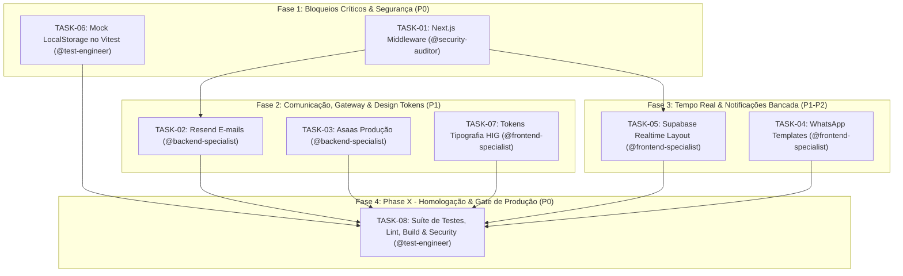

# Plano de Lançamento em Produção do MVP — Trust Care SaaS

> **Arquivo:** `mvp-production-launch.md`  
> **Status:** Executável / Pronto para Implementação  
> **Versão:** 1.0.0  
> **Base Tecnológica:** Next.js 16.2.9 (App Router / Node Runtime), React 19.2.4, TypeScript 5, Tailwind CSS v4, Supabase SSR & Realtime, Resend, Asaas Payment Gateway.  
> **Estado de Partida:** 111/112 testes passando, 0 erros TypeScript (`tsc --noEmit`), RPCs transacionais atômicas ativas, 7 violações de tipografia legada no design system e ausência de middleware raiz ativo.

---

## 1. Visão Geral do Escopo & Arquitetura

O objetivo deste plano é fechar com rigor técnico as **5 lacunas críticas restantes** para viabilizar a entrada do Trust Care SaaS em produção com segurança perimetral, feedback visual instantâneo para técnicos em bancada, estabilidade de testes unitários e conformidade estrita com o Design System orientado ao Apple HIG.

### As 5 Metas Principais
1. **Segurança Perimetral & Sessão (`middleware.ts`):** Estabelecer o middleware raiz do Next.js compatível com a arquitetura Next.js 16 (`proxy.ts` / `middleware.ts`) com `@supabase/ssr`, blindando rotas `/dashboard/*` e `/backoffice/*`, com persistência e renovação segura de cookies, redirecionamento de não autenticados (`/login?next=...`) e impedimento de acesso às telas públicas de auth para usuários já logados.
2. **Comunicação Transacional & Billing Seguro:** Validar o pipeline de e-mails transacionais via Resend (disparo de OTP de 6 dígitos criptografado por hash SHA-256 e links de orçamento/rastreio), estruturar os links e templates de WhatsApp com telefone dinâmico, e formalizar o checklist de variáveis de ambiente de produção para o Asaas (com desativação estrita do modo simulador `ENABLE_BILLING_SIMULATION=0`).
3. **Feedback Visual em Tempo Real (Supabase Realtime):** Implementar canal de subscrição WebSocket no `DashboardLayout` para eventos de atualização de Ordens de Serviço (`service_orders`), disparando alertas de áudio/toasts imediatos na bancada assim que o cliente aprova o orçamento ou quando o status avança.
4. **Estabilidade de Testes & Conformidade com Design System:** Corrigir o mock de `localStorage` em `lib/utils/reportFormatter.test.ts` no ambiente Node do Vitest (elevando a suíte para 112/112 testes verdes) e eliminar as 7 classes literais de tipografia em `PendingPartsTab.tsx` e `KpiOverviewCards.tsx`, garantindo nota máxima no `npm run ds:audit`.
5. **Homologação, Verificação Final & Phase X:** Executar a esteira de auditoria automatizada de segurança, testes unitários, checagem de tipos e build de produção sem advertências.

---

## 2. Matriz de Agentes Responsáveis

| Agente | Especialidade / Papel | Skills AG Kit Vinculadas | Responsabilidades Principais |
| :--- | :--- | :--- | :--- |
| **`security-auditor`** | Segurança de Sessão & Perímetro | `security-audit`, `clean-code`, `vulnerability-scanner` | Implementação do `middleware.ts`, proteção de cookies SSR, validação `isPlatformAdmin`, timing-safe webhook token checks. |
| **`backend-specialist`** | APIs, Integrações & Serviços | `api-patterns`, `database-design`, `clean-code` | Serviços de e-mail Resend, endurecimento das rotas Asaas, parametrização de ambiente de produção e links WhatsApp. |
| **`frontend-specialist`** | Interface, HIG Tokens & Realtime | `frontend-design`, `nextjs-react-expert`, `clean-code` | Subscrição Supabase Realtime no `DashboardLayout`, toasts de bancada, migração de classes literais para tokens semânticos (`text-caption`). |
| **`test-engineer`** | QA, Testes & Homologação | `testing-patterns`, `lint-and-validate`, `webapp-testing` | Correção do mock de `localStorage` no Vitest, execução da suíte completa de testes, validação de tipagem e script de auditoria final. |

---

## 3. Breakdown Detalhado de Tarefas por Agente & DoD

### TASK-01: Segurança e Sessão Perimetral (Next.js Middleware)
- **ID:** `TASK-01`
- **Agente Responsável:** `security-auditor`
- **Skills:** `security-audit`, `clean-code`
- **Prioridade:** P0 (Blocker)
- **Dependências:** Nenhuma
- **Arquivos Afetados:** `middleware.ts` (raiz), `proxy.ts` (raiz)
- **Contexto:** No Next.js 16 (`16.2.9`), o arquivo de rede perimetral foi padronizado em `proxy.ts`, porém a convenção canônica do Next.js e de middlewares externos espera interoperabilidade através do ponto de entrada `middleware.ts`. O projeto já possui a lógica de autenticação SSR em `proxy.ts`, porém deve-se garantir que o Next.js execute efetivamente as proteções de rota e refresh de cookies.
- **INPUT → OUTPUT → VERIFY:**
  - *INPUT:* Requisições HTTP entrantes para `/dashboard/*`, `/backoffice/*`, `/login`, `/register`, `/portal/dashboard`.
  - *OUTPUT:* Arquivo `middleware.ts` na raiz sincronizado com as diretrizes do Next.js 16, chamando a lógica de `proxy.ts` ou exportando a função middleware canônica que utiliza `createServerClient` de `@supabase/ssr`.
  - *VERIFY:*
    1. Acessar `/dashboard` sem cookies de sessão retorna redirecionamento 307 para `/login?next=%2Fdashboard`.
    2. Acessar `/login` com sessão de usuário autenticada redireciona 307 para `/dashboard`.
    3. Acessar `/backoffice` com usuário comum (não admin de plataforma) redireciona para `/dashboard`.
- **Critérios de Aceite (DoD):**
  - [ ] `middleware.ts` criado e configurado com `matcher` que intercepta todas as rotas da aplicação, exceto assets estáticos (`_next/static`, `_next/image`, `favicon.ico`, imagens).
  - [ ] Cookies do Supabase são lidos e atualizados de forma segura no request e response headers (`getAll` / `setAll`).
  - [ ] O parâmetro `?next=` é preservado de forma sanitizada para garantir o redirecionamento pós-login.
  - [ ] Nenhuma rota privada pode ser servida sem validação de sessão.
- **Estratégia de Rollback:** Reverter o arquivo `middleware.ts` para o estado anterior via git caso haja loops de redirecionamento ou bloqueio indevido de rotas estáticas.

---

### TASK-02: Comunicação Transacional de E-mails com Resend
- **ID:** `TASK-02`
- **Agente Responsável:** `backend-specialist`
- **Skills:** `api-patterns`, `clean-code`
- **Prioridade:** P1 (Alta)
- **Dependências:** `TASK-01`
- **Arquivos Afetados:** `lib/services/email.ts`, `app/api/notify/route.ts`, `app/api/rastreio/request-token/route.ts`, `app/api/portal/request-otp/route.ts`
- **Contexto:** O sistema envia e-mails em 4 momentos vitais: (1) Abertura de OS, (2) Orçamento Pronto para aprovação pelo cliente, (3) Equipamento Pronto para Retirada, e (4) Código de verificação OTP (6 dígitos com hash SHA-256) para rastreio e portal.
- **INPUT → OUTPUT → VERIFY:**
  - *INPUT:* Evento de notificação com parâmetros validados (`order_id`, `status`, e-mail destinatário).
  - *OUTPUT:* Template HTML responsivo, seguro contra injeção de HTML/links maliciosos via `escapeHtml` e `safeUrl`, despachado via API oficial do Resend.
  - *VERIFY:*
    1. Rodar `npx vitest run lib/services/email.test.ts` e validar os 2 testes unitários de e-mail passando.
    2. Disparo de teste para endereço verificado confirma formatação do template, cabeçalho Trust Care e botão de ação funcional.
- **Critérios de Aceite (DoD):**
  - [x] Variável `RESEND_API_KEY` devidamente documentada no `.env.example`.
  - [x] Fallback transparente documentado: fora de produção sem chave, a função simula o envio sem quebrar a execução; em produção sem chave, falha de forma controlada (`503 Service Unavailable`).
  - [x] Templates de e-mail respeitam a paleta de cores escura com contraste alto e sem dependência de estilos externos que quebram no Gmail/Outlook.
  - [x] Os links de aprovação de orçamento apontam para `${process.env.NEXT_PUBLIC_SITE_URL}/orcamento/${orderId}` de forma absoluta.
- **Estratégia de Rollback:** Desativar a flag de envio real mantendo o modo de simulação em log caso a API do Resend rejeite o domínio remetente.

---

### TASK-03: Formalização e Hardening do Gateway Asaas (Billing de Produção)
- **ID:** `TASK-03`
- **Agente Responsável:** `backend-specialist`
- **Skills:** `api-patterns`, `database-design`
- **Prioridade:** P1 (Alta)
- **Dependências:** Nenhuma (independente)
- **Arquivos Afetados:** `app/api/checkout/asaas/route.ts`, `app/api/webhooks/asaas/route.ts`, `.env.example`
- **Contexto:** O Asaas gerencia planos Starter, Pro e Premium via assinaturas mensais. Em desenvolvimento existia a flag `ENABLE_BILLING_SIMULATION=1` que ativava assinaturas sem pagamento real. Para produção, essa flag DEVE ser desativada, e a validação do webhook do Asaas deve ser rigorosa com proteção contra replay e timing attacks.
- **INPUT → OUTPUT → VERIFY:**
  - *INPUT:* Requisição de checkout de plano ou webhook de notificação (`PAYMENT_RECEIVED`, `PAYMENT_OVERDUE`, `SUBSCRIPTION_CANCELED`).
  - *OUTPUT:* Resposta 200 OK com processamento idempotente via tabela `billing_events` e token validado por `crypto.timingSafeEqual`.
  - *VERIFY:*
    1. Rodar `npx vitest run lib/services/billing.test.ts` e validar os 4 testes passando.
    2. Verificar que se `ENABLE_BILLING_SIMULATION` não for explicitamente `'1'`, qualquer tentativa de simulação retorna erro 503.
- **Critérios de Aceite (DoD):**
  - [x] `ENABLE_BILLING_SIMULATION` documentado explicitamente como `0` para ambiente de produção.
  - [x] Webhook do Asaas em `app/api/webhooks/asaas/route.ts` exige cabeçalho `asaas-access-token` e compara em tempo constante com `ASAAS_WEBHOOK_TOKEN`.
  - [x] Tratamento estrito de idempotência no banco de dados para evitar reativações ou renovações duplicadas da mesma fatura.
  - [x] URLs de redirecionamento pós-checkout sanitizadas via `safeRedirect`.
- **Estratégia de Rollback:** Reverter qualquer alteração nos manipuladores de webhook mantendo as regras estritas da migração `20261017230000_billing_events_idempotency.sql`.

---

### TASK-04: Padronização dos Templates e Links de Notificação via WhatsApp
- **ID:** `TASK-04`
- **Agente Responsável:** `frontend-specialist`
- **Skills:** `frontend-design`, `clean-code`
- **Prioridade:** P2 (Média)
- **Dependências:** Nenhuma
- **Arquivos Afetados:** `app/(dashboard)/dashboard/orders/[id]/_components/OrderHeader.tsx`, `components/ui/WhatsAppButton.tsx`, `app/rastreio/RastreioClient.tsx`
- **Contexto:** No header de detalhes da OS (`OrderHeader.tsx`) o link de WhatsApp para enviar o orçamento ao cliente atualmente possui URL genérica `https://wa.me/?text=...` sem o número do cliente pré-preenchido. Além disso, em `RastreioClient.tsx` há um número fixo de telefone que deve ser substituído pelo canal de suporte dinâmico da empresa logada.
- **INPUT → OUTPUT → VERIFY:**
  - *INPUT:* Dados da OS, código legível da OS (`codigo_os`), nome do cliente e número de WhatsApp formatado.
  - *OUTPUT:* Link WhatsApp canônico no formato `https://wa.me/55${cleanPhone}?text=${encodedMessage}` ou fallback seguro quando não houver telefone.
  - *VERIFY:*
    1. Inspecionar o botão de WhatsApp no cabeçalho da OS: ao clicar, abre o WhatsApp Web / App direcionado ao número do cliente com a mensagem pré-preenchida.
    2. Mensagem inclui o link direto para aprovação de orçamento: `.../orcamento/[id]`.
- **Critérios de Aceite (DoD):**
  - [ ] O número do cliente tem caracteres não-dígitos sanitizados antes da interpolação na URL do WhatsApp.
  - [ ] O texto da mensagem utiliza formatação limpa: "Olá [Nome], seu orçamento para a OS #[Código] está pronto para avaliação. Acesse o link seguro para aprovar ou recusar: [URL]".
  - [ ] Em `RastreioClient.tsx`, o botão de suporte utiliza o WhatsApp configurado nos dados da empresa ou fallback seguro.
- **Estratégia de Rollback:** Reversão simples dos componentes visuais modificados.

---

### TASK-05: Escuta Supabase Realtime no DashboardLayout
- **ID:** `TASK-05`
- **Agente Responsável:** `frontend-specialist`
- **Skills:** `nextjs-react-expert`, `clean-code`
- **Prioridade:** P1 (Alta)
- **Dependências:** `TASK-01`
- **Arquivos Afetados:** `app/(dashboard)/layout.tsx`
- **Contexto:** O técnico ou atendente que está no dashboard precisa saber imediatamente quando um cliente aprova um orçamento no portal público ou quando uma OS tem seu status alterado em outra bancada, sem precisar recarregar a página manualmente (F5).
- **INPUT → OUTPUT → VERIFY:**
  - *INPUT:* Canal de Realtime Supabase assinado na tabela `service_orders` filtrado por `company_id=eq.${company.id}`.
  - *OUTPUT:* Toast de alta visibilidade e disparo de evento local `window.dispatchEvent(new CustomEvent('os-status-updated', ...))` para sincronizar abas e tabelas ativas.
  - *VERIFY:*
    1. Simular uma aprovação de orçamento (atualização do campo `budget_approved_at` ou mudança de status para `'Em Andamento'`): o `DashboardLayout` emite toast informativo imediatamente.
    2. Ao desmontar o layout ou trocar de tenant, o canal do Supabase é desinscrito corretamente (`supabase.removeChannel(channel)`), evitando vazamento de memória.
- **Critérios de Aceite (DoD):**
  - [ ] `useEffect` no `DashboardLayoutContent` inicializa subscrição apenas quando `company?.id` estiver disponível.
  - [ ] Filtro estrito por tenant (`company_id=eq.${company.id}`) para garantir isolamento multi-tenant no WebSocket.
  - [ ] Diferenciação visual dos alertas: aprovação de orçamento pelo cliente recebe toast de comemoração/sucesso; alteração geral de status recebe toast de informação.
  - [ ] Função de cleanup do `useEffect` remove o canal ativo para evitar canais zumbis.
- **Estratégia de Rollback:** Desativar a subscrição do canal no `layout.tsx` caso ocorra desconexão intermitente do WebSocket.

---

### TASK-06: Correção do Teste Unitário (Mock de LocalStorage no Vitest)
- **ID:** `TASK-06`
- **Agente Responsável:** `test-engineer`
- **Skills:** `testing-patterns`, `clean-code`
- **Prioridade:** P0 (Blocker)
- **Dependências:** Nenhuma (independente)
- **Arquivos Afetados:** `lib/utils/reportFormatter.test.ts`
- **Contexto:** O teste unitário `lib/utils/reportFormatter.test.ts` falha no Node 22 com `TypeError: Cannot read properties of undefined (reading 'setItem')` e `ExperimentalWarning: localStorage is not available because --localstorage-file was not provided`. Isso impede a suíte de testes de fechar com 100% de sucesso.
- **INPUT → OUTPUT → VERIFY:**
  - *INPUT:* Execução do Vitest em ambiente Node onde `globalThis.localStorage` não possui persistência de arquivo.
  - *OUTPUT:* Mock em memória no arquivo de teste (`vi.stubGlobal('localStorage', ...)` ou `storageMock` com `getItem`, `setItem`, `removeItem`, `clear`).
  - *VERIFY:*
    1. Executar `npx vitest run lib/utils/reportFormatter.test.ts`.
    2. Todos os 12 testes do arquivo devem passar com sucesso (`✓ deve salvar e carregar templates do localStorage`).
- **Critérios de Aceite (DoD):**
  - [ ] O mock isola o estado do storage entre os testes (`beforeEach` limpando o map interno).
  - [ ] Nenhuma dependência externa adicionada desnecessariamente.
  - [ ] `npx vitest run lib/utils/reportFormatter.test.ts` retorna exit code 0.
- **Estratégia de Rollback:** Reverter alterações no arquivo de teste.

---

### TASK-07: Adequação dos Tokens Tipográficos ao Design System (Apple HIG)
- **ID:** `TASK-07`
- **Agente Responsável:** `frontend-specialist`
- **Skills:** `frontend-design`, `clean-code`
- **Prioridade:** P1 (Alta)
- **Dependências:** Nenhuma
- **Arquivos Afetados:** `app/(dashboard)/dashboard/inventory/PendingPartsTab.tsx`, `components/dashboard/KpiOverviewCards.tsx`
- **Contexto:** O comando `npm run ds:audit` identifica 7 instâncias de texto abaixo do piso de 12px (`text-[10px]`, `text-[11px]`) e 1 uso de `text-xs` avulso nesses 2 arquivos. O Design System do Trust Care define o piso tipográfico de 12px através do token semântico `text-caption`.
- **INPUT → OUTPUT → VERIFY:**
  - *INPUT:* Classes literais em `PendingPartsTab.tsx` (linhas 428, 453, 477) e `KpiOverviewCards.tsx` (linhas 127, 150, 161, 166, 206).
  - *OUTPUT:* Substituição das classes arbitrárias pelos tokens semânticos oficiais (`text-caption`, `text-small`).
  - *VERIFY:*
    1. Executar `npm run ds:audit`.
    2. O relatório deve acusar **0** textos abaixo do piso de 12px e **0** `text-xs` avulsos, atingindo 100% de conformidade com o design system.
- **Critérios de Aceite (DoD):**
  - [ ] Linha 428 de `PendingPartsTab.tsx`: `text-[11px]` → `text-caption`.
  - [ ] Linha 453 de `PendingPartsTab.tsx`: `text-[10px]` → `text-caption`.
  - [ ] Linha 477 de `PendingPartsTab.tsx`: `text-[11px]` → `text-caption`.
  - [ ] Linhas 127, 161, 166, 206 de `KpiOverviewCards.tsx`: `text-[11px]` → `text-caption`.
  - [ ] Linha 150 de `KpiOverviewCards.tsx`: `text-xs` → `text-caption`.
  - [ ] Nenhuma quebra visual de layout ou estouro de badges nos cards e tabelas.
- **Estratégia de Rollback:** Reverter as edições dos arquivos caso haja desalinhamento visual indesejado.

---

### TASK-08: Bateria de Testes, Lint e Auditoria de Segurança Final (Phase X)
- **ID:** `TASK-08`
- **Agente Responsável:** `test-engineer`
- **Skills:** `lint-and-validate`, `security-audit`, `webapp-testing`
- **Prioridade:** P0 (Critério de Liberação)
- **Dependências:** `TASK-01`, `TASK-02`, `TASK-03`, `TASK-04`, `TASK-05`, `TASK-06`, `TASK-07`
- **Arquivos Afetados:** Todos os arquivos do projeto
- **Contexto:** Validação integral antes do deploy. O projeto deve apresentar 100% de aprovação na suíte de testes unitários, zero erros no linter, tipagem TypeScript estrita e auditoria de vulnerabilidades zerada.
- **INPUT → OUTPUT → VERIFY:**
  - *INPUT:* Código consolidado com todas as correções aplicadas.
  - *OUTPUT:* Relatórios limpos de execução de `npm test`, `npm run lint`, `npx tsc --noEmit`, `npm run ds:audit` e `npm run build`.
  - *VERIFY:*
    1. `npm test` finaliza com 17 suítes aprovadas e 112 testes passando.
    2. `npm run lint` executa com sucesso.
    3. `npx tsc --noEmit` retorna exit code 0.
    4. `npm run ds:audit` retorna 5 de 5 indicadores aprovados.
    5. `npm run build` compila o Next.js gerando as rotas de produção sem erros de SSR ou hidratação.
- **Critérios de Aceite (DoD):**
  - [ ] 0 falhas na suíte de testes Vitest.
  - [ ] 0 erros de tipagem TypeScript.
  - [ ] Build de produção gerado com sucesso em `.next/`.
- **Estratégia de Rollback:** Bloquear o deploy em caso de qualquer falha na esteira automatizada.

---

## 4. Ordem Sequencial e Paralelismo Seguro

O plano foi estruturado para maximizar o paralelismo seguro entre agentes especialistas de domínios distintos, convergindo para a homologação final:

### Regras de Paralelismo
- **Trabalho Concorrente Liberado:**
  - `security-auditor` em `TASK-01` e `test-engineer` em `TASK-06` trabalham em paralelo, pois tocam arquivos totalmente desacoplados (`middleware.ts` e `reportFormatter.test.ts`).
  - `backend-specialist` (`TASK-02`, `TASK-03`) atua simultaneamente a `frontend-specialist` (`TASK-07`).
- **Gargalo Sequencial Obrigatório:**
  - `TASK-08` só pode ser disparada após a conclusão integral de todas as tarefas anteriores (Phase X Gate).

---

## 5. Roteiro de Verificação & Testes de Aceitação

### 5.1 Checklist de Variáveis de Ambiente de Produção

As seguintes variáveis são estritamente obrigatórias para o ambiente de produção na Vercel / servidor de hospedagem:

| Variável de Ambiente | Descrição / Papel | Exemplo de Formato | Risco de Omissão / Configuração Incorreta |
| :--- | :--- | :--- | :--- |
| `NEXT_PUBLIC_SUPABASE_URL` | URL do projeto Supabase | `https://xyzcompany.supabase.co` | Aplicação não conecta ao banco nem autentica usuários. |
| `NEXT_PUBLIC_SUPABASE_ANON_KEY` | Chave pública anônima do Supabase | `eyJhbGciOi...` | Falha imediata na renderização client-side. |
| `SUPABASE_SERVICE_ROLE_KEY` | Chave administrativa backend (segredo) | `eyJhbGciOi...` | Quebra dos webhooks, cron jobs e envio de tokens OTP. |
| `RESEND_API_KEY` | Chave de produção da API do Resend | `re_abc123456...` | E-mails transacionais não são disparados para os clientes. |
| `RESEND_FROM_EMAIL` | Remetente homologado com SPF/DKIM | `Trust Care <nao-responda@trustcare.com.br>` | E-mails caem em SPAM ou são rejeitados pelo Resend. |
| `NEXT_PUBLIC_SITE_URL` | Domínio canônico da aplicação web | `https://app.trustcare.com.br` | Links de e-mail e botões de WhatsApp geram URLs quebradas. |
| `ASAAS_API_KEY` | Token de produção do Asaas | `$aact_YTU5YTE0M2M2...` | Falha na criação de faturas e assinaturas de planos. |
| `ASAAS_BASE_URL` | Endpoint da API do Asaas | `https://api.asaas.com/v3` | Transações podem ser enviadas indevidamente para a sandbox. |
| `ASAAS_WEBHOOK_TOKEN` | Token do webhook configurado no Asaas | `token_secreto_webhook_987` | Webhook de confirmação de pagamento rejeitado com 401. |
| `ENABLE_BILLING_SIMULATION` | Flag de simulação de pagamentos | `0` (ou ausente) | Se configurado como `1`, permite assinaturas fraudulentas sem pagamento. |
| `NEXT_PUBLIC_PORTAL_SESSION_SECRET`| Segredo de criptografia da sessão do portal | String randômica de 64 caracteres | Tokens de sessão do cliente tornam-se previsíveis. |

---

### 5.2 Roteiro de Testes de Aceitação Ponta a Ponta

| Cenário de Teste | Ação Executada | Resultado Esperado | Validação Técnica |
| :--- | :--- | :--- | :--- |
| **C1: Barreira de Autenticação** | Acessar `/dashboard` numa janela anônima limpa. | Redirecionamento instantâneo para `/login?next=%2Fdashboard`. | HTTP 307 + query param `next`. |
| **C2: Login com Redirecionamento** | Informar credenciais válidas na tela de login. | Autenticação bem-sucedida e retorno automático para a rota indicada no `next`. | Cookie SSR gravado + rota privada carregada. |
| **C3: Proteção de Backoffice** | Tentar acessar `/backoffice` com usuário técnico ou recepcionista. | Acesso negado e redirecionamento para o dashboard regular. | Função `isPlatformAdmin` retorna falso. |
| **C4: Solicitação de OTP no Rastreio** | Digitar o código de uma OS na tela `/rastreio`. | E-mail disparado com código OTP de 6 dígitos; hash gravado em `os_verifications`. | Resend API retorna ID de envio; código confere com o hash. |
| **C5: Aprovação de Orçamento pelo Cliente**| Cliente abre link `/orcamento/[id]` e clica em "Aprovar Orçamento". | Status da OS muda para "Em Andamento", grava data e gera histórico. | RPC `approve_budget_by_client` executada atomicamente. |
| **C6: Alerta Realtime na Bancada** | Com o dashboard aberto, o cliente aprova o orçamento externamente. | Toast verde de notificação surge imediatamente na tela do técnico sem recarregar a página. | Evento `postgres_changes` capturado pelo canal WebSocket. |
| **C7: Checkout e Webhook Asaas** | Envio de webhook simulando `PAYMENT_RECEIVED` com token correto. | Assinatura da empresa ativada por 30 dias e evento registrado em `billing_events`. | Verificação em tempo constante e resposta HTTP 200. |
| **C8: Suíte Completa de Testes** | Execução de `npm test`. | 112 de 112 testes passando sem erros de localStorage. | Exit code 0, 0 erros no Vitest. |
| **C9: Auditoria de Design System** | Execução de `npm run ds:audit`. | Todos os 5 indicadores aprovados (0 diálogos nativos, 0 cores fora do token, 0 fontes < 12px). | Relatório com 100% dos arquivos em conformidade. |

---

## 6. Checklist de Execução & Conclusão

Ao executar este plano, o orchestrator ou os agentes especialistas devem atualizar o progresso marcando as caixas abaixo:

- [ ] **Fase 1: Bloqueios Críticos & Segurança**
  - [ ] `TASK-01`: `middleware.ts` implementado e verificado com proteção de rotas.
  - [ ] `TASK-06`: `lib/utils/reportFormatter.test.ts` corrigido com mock de localStorage (12/12 testes passando).
- [ ] **Fase 2: Serviços, Comunicação & Design System**
  - [ ] `TASK-02`: Pipeline de e-mails transacionais Resend validado.
  - [ ] `TASK-03`: Asaas configurado para produção (`ENABLE_BILLING_SIMULATION=0`).
  - [ ] `TASK-07`: 7 classes de tipografia ajustadas para `text-caption` em `PendingPartsTab.tsx` e `KpiOverviewCards.tsx`.
- [ ] **Fase 3: Tempo Real & Notificações de Bancada**
  - [ ] `TASK-05`: Supabase Realtime escutando `service_orders` no `DashboardLayout`.
  - [ ] `TASK-04`: Links de WhatsApp dinâmicos no cabeçalho da OS.
- [ ] **Fase 4: Phase X - Homologação Final**
  - [ ] `TASK-08`: `npm test` aprovado (112/112).
  - [ ] `TASK-08`: `npm run lint` aprovado sem erros.
  - [ ] `TASK-08`: `npx tsc --noEmit` aprovado com 0 erros.
  - [ ] `TASK-08`: `npm run ds:audit` com 100% de conformidade.
  - [ ] `TASK-08`: `npm run build` gerando bundle de produção com sucesso.
