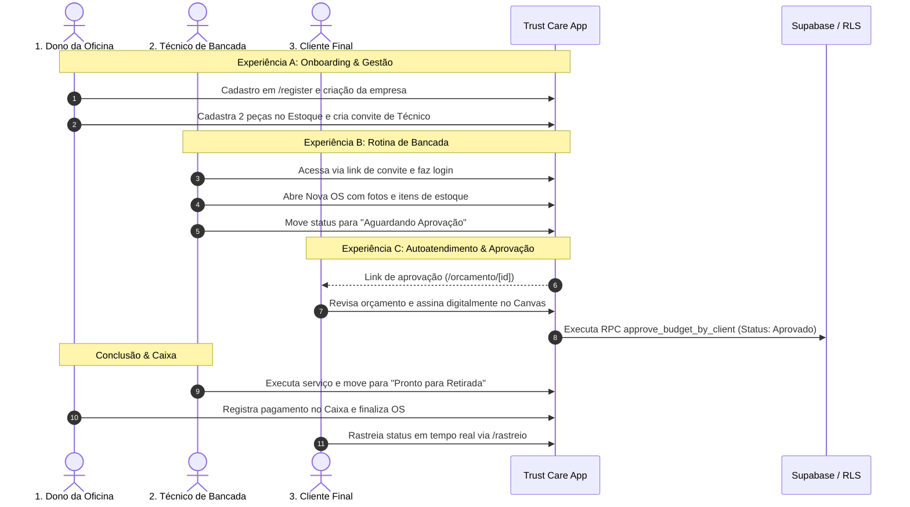

# Plano Estruturado de Testes com Técnicos — MVP Trust Care SaaS

> **Arquivo:** `mvp-technician-testing-plan.md`  
> **Status:** Proposta de Planejamento (Fase 1 / Orquestração)  
> **Versão:** 1.0.0  
> **Ambiente Alvo:** Homologação / Staging (Vercel Preview/Staging + Supabase)  
> **Público do Teste:** 3 a 5 técnicos/donos de assistência técnica selecionados (Beta Fechado)  

---

## 1. Visão Geral & Objetivos do Teste

O objetivo deste plano é colocar o MVP do **Trust Care (OS Manager)** em condições reais de bancada e atendimento, colhendo feedback técnico e de negócio antes de qualquer abertura pública.

### Metas Principais:
1. **Validar a Ergonomia de Bancada:** Medir o tempo que um técnico leva para dar entrada em um equipamento, tirar fotos da avaria e gerar um laudo preliminar.
2. **Validar a Conversão do Orçamento Digital:** Confirmar se o cliente final acha o link de orçamento (`/orcamento/[id]`) intuitivo e se assina sem dúvidas.
3. **Validar o Isolamento & Estabilidade:** Garantir que o sistema não apresente travamentos, telas brancas ou vazamento de dados entre empresas distintas durante o uso simultâneo.

---

## 2. Checklist Técnico de Staging (Pré-Voo Obrigatório)

Antes de enviar qualquer link para os técnicos, o ambiente de homologação deve estar configurado:

- [ ] **Deploy de Staging:** Branch ativa com deploy dedicado na Vercel (ex: `staging.trustcare.app` ou preview URL estável).
- [ ] **Banco de Dados Supabase (Staging):** Projeto com migrations atualizadas (`supabase/migrations/`) e RLS estritamente habilitado.
- [ ] **Variáveis de Ambiente Chave:**
  - `NEXT_PUBLIC_SITE_URL`: Configurado com a URL exata de staging (essencial para que os links de orçamento e rastreio gerados apontem para o local correto).
  - `ENABLE_BILLING_SIMULATION="1"`: Ativo em staging para que os técnicos testem os planos Starter, Pro e Premium sem serem cobrados no Asaas.
  - `RESEND_API_KEY`: Configurado com domínio verificado (para disparo real de e-mails de teste) ou documentado o comportamento em modo simulação.
- [ ] **Storage Buckets:** Buckets `company-logos` e `order-attachments` criados e com políticas de leitura pública/escrita autenticada ativas.
- [ ] **Contas de Teste Pré-Criadas (Opcional):** Uma empresa modelo com peças fictícias (ex: telas, baterias, pasta térmica) já cadastradas para o técnico não começar do zero se não quiser cadastrar estoque.

---

## 3. Matriz de Teste das 3 Experiências (Ponta a Ponta)



### Experiência A: O Dono da Oficina (Visão Gestão)
* **Objetivo:** Sentir que o sistema economiza tempo administrativo e organiza a empresa.
* **Passo a Passo:**
  1. Acessar `/register` e criar a conta da assistência (nome, WhatsApp, logo).
  2. Acessar `Configurações > Equipe` e gerar um link de convite para um colega.
  3. Acessar `Estoque` e cadastrar 2 produtos (ex: "Bateria iPhone 13", "SSD NVMe 512GB") com quantidade e preço de custo/venda.
  4. Acessar `Financeiro` após a finalização da OS para conferir se o lucro bruto bateu com o esperado.

### Experiência B: O Técnico de Bancada (Visão Operacional)
* **Objetivo:** Validar velocidade, ergonomia e facilidade de registrar os serviços sem atrito.
* **Passo a Passo:**
  1. Abrir o formulário de Nova OS em `/dashboard/orders?new=true`.
  2. Preencher dados do cliente e aparelho (marca, modelo, serial, senha/padrão de desbloqueio).
  3. Preencher o Checklist de Entrada (ex: tela riscada, botão com defeito, carcaça amassada) e anexar fotos se estiver no celular.
  4. Adicionar Mão de Obra e associar a peça do estoque criada no passo anterior.
  5. Mover a OS para "Aguardando Aprovação".
  6. Simular a execução do serviço e mover para "Pronto para Retirada".

### Experiência C: O Cliente Final (Visão Transparência)
* **Objetivo:** Validar credibilidade, segurança jurídica e clareza da proposta.
* **Passo a Passo:**
  1. Abrir no smartphone o link gerado: `${URL}/orcamento/${ORDER_ID}`.
  2. Verificar os valores discriminados (peças vs serviços).
  3. Desenhar a assinatura na tela com o dedo e preencher o nome completo.
  4. Clicar em "Aprovar Orçamento" e verificar se a tela confirma instantaneamente.
  5. Acessar `/rastreio`, digitar o código da OS (ex: `TC-2026-0001`) e verificar o status atualizado.

---

## 4. Script de Abordagem & Explicação para os Técnicos

> Como abordar os técnicos por WhatsApp, ligação ou áudio de forma profissional, valorizando o conhecimento deles e deixando claro o objetivo do teste.

### Opção 1: Mensagem Direta no WhatsApp (Texto)

```text
Fala [Nome do Técnico], tudo bem?

Estou desenvolvendo uma plataforma nova focada exclusivamente na rotina de assistência técnica e bancada de TI — chamada Trust Care.

A ideia central dela é eliminar as maiores dores de quem conserta equipamento no dia a dia:
1. Agilizar a entrada de OS em menos de 1 minuto (inclusive com fotos da avaria).
2. Enviar um link de aprovação pro WhatsApp do cliente com assinatura digital na tela do celular (acaba com cliente dizendo depois "eu não autorizei esse valor").
3. Rastreamento em tempo real pro cliente parar de ficar mandando mensagem perguntando "ficou pronto?".

Como sei da sua experiência real de bancada, queria muito te convidar para ser um dos primeiros técnicos a testar a versão beta fechada.

Você toparia simular uma ou duas ordens de serviço fictícias (ou de bancada real) no sistema ao longo desta semana para me dizer o que achou de verdade, sem filtro?

Se topar, te mando o link de acesso e um roteirinho rápido de 3 minutos! Valeu demais!
```

### Opção 2: Roteiro para Mensagem de Áudio (1 minuto)

> *"Fala [Nome], beleza? Cara, estou te mandando esse áudio porque estou finalizando o MVP de um sistema de gestão e OS para assistência técnica, o Trust Care. E como você tá na trincheira todo dia lidando com cliente indeciso, peça e bancada, a sua opinião técnica vale ouro pra mim. O sistema já tem aprovação de orçamento por assinatura no celular do cliente e controle de estoque com baixa automática. Eu montei um ambiente de teste e queria saber se você topa entrar, criar uma OS de teste e me dar um feedback sincero do que tá bom e o que tá travando na usabilidade real. Posso te enviar o link de acesso?"*

---

## 5. Questionário Estruturado de Feedback (`to-questionnaire`)

**Propósito:** Identificar atritos de UX, funcionalidades faltantes e a real disposição de uso do sistema.  
**De:** Luan (Trust Care) · **Para:** Técnico/Dono de Assistência Beta Tester  

### Bloco 1: Abertura e Entrada do Aparelho (Bancada)
1. **Quanto tempo você levou para cadastrar a OS e o aparelho?**  
   `[ ] Menos de 2 minutos  [ ] De 2 a 5 minutos  [ ] Mais de 5 minutos (achei cansativo)`
2. **O checklist de estado físico e relato de defeito atendeu o que você costuma checar na bancada?**  
   _Por que importa: decide se precisamos criar templates customizáveis de checklist por tipo de aparelho (ex: celular vs notebook vs impressora)._  
   `>`
3. **Sentiu falta de algum campo crucial na hora de dar entrada no equipamento?**  
   `>`

### Bloco 2: Orçamento e Aprovação do Cliente
4. **O que você achou da tela que o cliente recebe para assinar com o dedo no celular?**  
   `[ ] Excelente, passa muita credibilidade  [ ] Boa, mas simples  [ ] Confusa para o cliente leigo`
5. **Seus clientes aprovariam mais rápido orçamentos com essa assinatura digital?**  
   `>`

### Bloco 3: Fechamento e Caixa
6. **O controle de peças do estoque e a finalização de pagamento com dinheiro/PIX/cartão foram claros?**  
   `>`

### Bloco 4: Pergunta Definitiva (Fit de Mercado)
7. **Se o Trust Care estivesse disponível amanhã por uma assinatura acessível, você usaria no lugar do seu controle atual (caderno/planilha/outro sistema)? O que impediria você de usar hoje?**  
   `>`

---

## 6. Matriz de Agentes Responsáveis pela Execução (Fase 2)

| Agente | Papel na Preparação do Teste |
| :--- | :--- |
| **`security-auditor`** | Validar permissões de RLS para impedir que tenants de teste vejam dados uns dos outros e auditar proteção de rotas. |
| **`test-engineer`** | Rodar e manter os testes E2E com Playwright simulando exatamente o fluxo do roteiro dos técnicos. |
| **`frontend-specialist`** | Ajustar responsividade de mobile na bancada e sanar os avisos de tokens de estilo em `RastreioClient.tsx`. |
